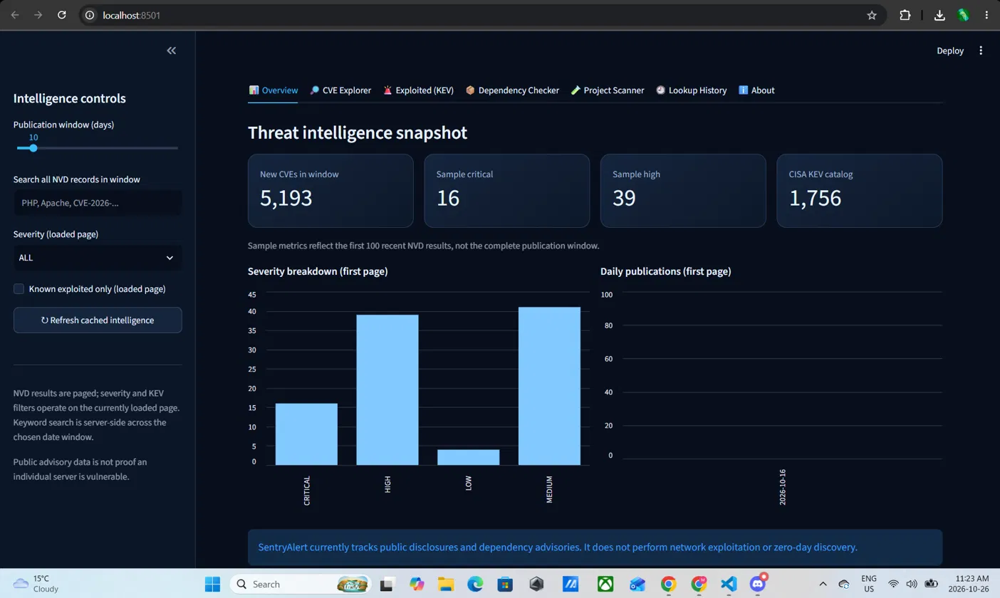

# 🛡️ SentryAlert v2

**Vulnerability intelligence dashboard and passive open-source dependency scanner**, built with Python and Streamlit.



SentryAlert combines public CVE data from NVD, CISA's Known Exploited Vulnerabilities (KEV) catalog, and OSV package advisories. Use it to explore security advisories and check declared dependency versions against known vulnerabilities.

## Features

- **Security dashboard:** NVD CVE explorer with severity filters, charts, pagination, and CSV exports.
- **CISA KEV:** browse vulnerabilities CISA lists as known exploited.
- **Dependency scanner:** check exact versions in supported manifests against OSV, up to **250 unique packages per scan**, with CSV and JSON exports.
- **Package lookup:** look up supported packages in OSV. Individual lookups can be saved to a local SQLite database.
- **GitHub alerts:** a scheduled GitHub Actions workflow checks for newly added CISA KEV entries and can open GitHub Issues.
- **Tests and deployment:** pytest tests, GitHub Actions CI, and Streamlit Community Cloud configuration.

## Technology

Python · Streamlit · Requests · pandas · SQLite · NVD API · CISA KEV · OSV API · pytest · GitHub Actions

## Repository layout

```text
SentryAlert/                         # GitHub repository root
├── .github/
│   └── workflows/
│       ├── kev-alerts.yml
│       └── tests.yml
└── SentryAlert/                     # Application folder (run everything from here)
    ├── .streamlit/
    │   └── config.toml
    ├── sentryalert/
    │   ├── __init__.py
    │   ├── alerts.py
    │   └── scanner.py
    ├── tests/
    │   └── test_scanner.py
    ├── app.py
    ├── requirements.txt
    └── .gitignore
```

## Quick start

Requires **Python 3.11 or 3.12**. Python 3.12 is recommended. Newer versions may not have prebuilt packages for pandas, and pip will then try to compile them.

```bash
git clone https://github.com/MYSTICOP221/SentryAlert.git
cd SentryAlert/SentryAlert
python3.12 -m venv .venv
.venv/bin/python -m pip install -r requirements.txt
.venv/bin/python -m streamlit run app.py
```

Open http://localhost:8501 in your browser. Stop the server with **Ctrl+C**.

Run every command from the **inner** `SentryAlert/` folder, the one that contains `app.py` and `requirements.txt`.

## Detailed setup

### macOS / Linux

```bash
cd SentryAlert/SentryAlert
python3.12 -m venv .venv
source .venv/bin/activate
python -m pip install -r requirements.txt
python -m streamlit run app.py
```

### Windows (PowerShell)

Install Python 3.12 from [python.org](https://www.python.org/downloads/) or with `winget install Python.Python.3.12`, then run:

```powershell
cd SentryAlert\SentryAlert
py -3.12 -m venv .venv
.\.venv\Scripts\python.exe -m pip install -r requirements.txt
.\.venv\Scripts\python.exe -m streamlit run app.py
```

Create the virtual environment once. You don't need to recreate it each time you run the app. Never commit the `.venv/` folder to GitHub.

If you already have the dependencies installed, skip the install step and run the Streamlit command directly.

## Dependency vulnerability scanner

The scanner accepts only these exact filenames:

| Ecosystem | Filename | Format |
|---|---|---|
| Python / PyPI | `requirements.txt` | Exact version pins, such as `requests==2.19.0` |
| JavaScript / npm | `package-lock.json` | npm lockfile |
| JavaScript / npm | `npm-shrinkwrap.json` | npm shrinkwrap lockfile |
| PHP / Packagist | `composer.lock` | Composer lockfile |

To try the scanner without installing anything vulnerable, create a file named `requirements.txt` containing:

```text
requests==2.19.0
urllib3==1.24.1
Jinja2==2.10
```

1. Start the app and open **Dependency Scanner**.
2. Upload the test `requirements.txt`.
3. Start the scan and review any OSV advisory matches.
4. Export the findings as CSV or JSON if you want.

These versions are deliberately outdated. **Don't install them.** Results depend on OSV's coverage and API availability. The scanner checks declared package versions. It does not execute packages or scan your computer or network.

## Run tests

From the inner application folder:

```bash
.venv/bin/python -m pip install pytest
.venv/bin/python -m pytest -q
```

On Windows, use `.\.venv\Scripts\python.exe` in place of `.venv/bin/python`.

## Automated CISA KEV alerts

The workflow lives at `.github/workflows/kev-alerts.yml` in the **repository root**.

1. In your GitHub repository settings, enable **Issues**.
2. To test it manually, go to **Actions → CISA KEV alerts → Run workflow**.
3. If the job can't create issues, check the workflow permissions and the repository's Actions settings. The workflow requests `issues: write` and uses the built-in `GITHUB_TOKEN`.
4. Check the run logs and the repository's **Issues** tab.

The workflow runs daily at about 09:17 UTC, subject to GitHub scheduling delays. A successful run may create no issues if there are no new entries. The current deduplication checks up to 100 existing issues, so large repositories may need pagination.

**Scope:** these alerts cover new entries in CISA's KEV catalog. They do not cover every new CVE, and they do not detect vulnerabilities on any device.

## Deploy to Streamlit Community Cloud

1. Push the project to GitHub.
2. Sign in at [Streamlit Community Cloud](https://share.streamlit.io/).
3. Create an app from GitHub with these settings:

| Setting | Value |
|---|---|
| Repository | `MYSTICOP221/SentryAlert` |
| Branch | `main` |
| Main file path | `SentryAlert/app.py` |

4. Deploy, then check the app logs if startup or API calls fail.

The hosted dashboard and the GitHub Actions alert workflow are separate services. Local SQLite data on Streamlit Community Cloud may reset on restart or redeployment. Persistent multi-user history requires managed storage and authentication.

## Security, privacy, and limitations

- SentryAlert performs **passive advisory matching**. It is not penetration testing, active network scanning, exploit verification, or zero-day detection.
- The Overview metrics and charts use only the first 100 NVD results in the selected window, not the full window.
- Missing advisory matches **don't prove software is secure**. Verify affected versions and mitigations against authoritative vendor advisories.
- Avoid uploading confidential dependency manifests to a public deployment unless you understand how the app and OSV process package information.
- Never commit API keys, credentials, `.env` files, local SQLite databases, `.venv/`, or private scan results. The `.gitignore` is meant to exclude common local files.
- External APIs can be unavailable or rate-limited.

## Data sources

- [NVD vulnerability API](https://nvd.nist.gov/developers/vulnerabilities)
- [CISA Known Exploited Vulnerabilities](https://www.cisa.gov/known-exploited-vulnerabilities-catalog)
- [OSV](https://osv.dev/)

## Future improvements

Additional ecosystems, SBOM support, better advisory prioritization, email or webhook notifications, persistent cloud storage, authentication, and broader test coverage.

## License

No license has been added yet, so all rights are reserved by default. Add a license file (MIT is a common choice for portfolio projects) if you want others to be able to reuse or contribute to the code.
